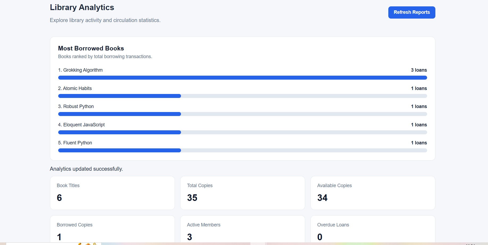
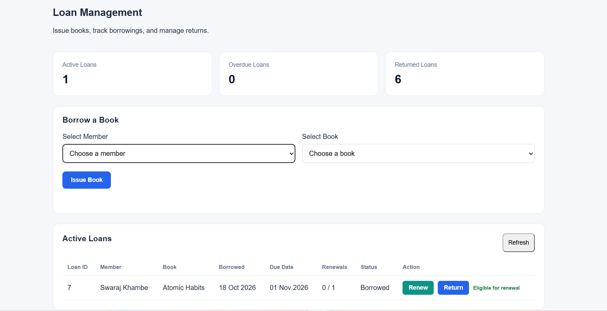
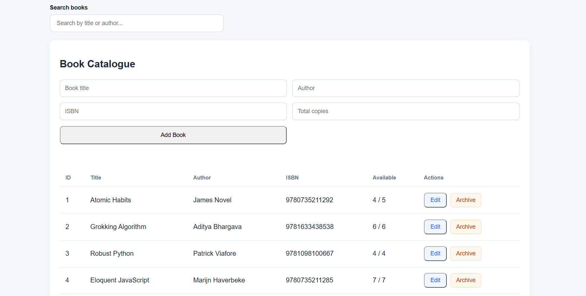

# LibraFlow — Library Management & Analytics System

LibraFlow is a full-stack library management application built with **Python, FastAPI, SQLAlchemy, SQLite, Alembic, Pydantic, Pytest, HTML, CSS, and vanilla JavaScript**.

It provides RESTful APIs and a web interface for managing books, members, borrowing transactions, loan policies, and library analytics.

The project demonstrates backend development concepts including relational database design, API validation, business logic, database transactions, schema migrations, SQL aggregation, and automated testing.

## Tech Stack

| Category | Technologies |
|---|---|
| Backend | Python, FastAPI |
| Database | SQLite, SQLAlchemy ORM |
| Data Validation | Pydantic |
| Configuration | Pydantic Settings |
| Database Migrations | Alembic |
| Testing | Pytest, FastAPI TestClient |
| Frontend | HTML5, CSS3, JavaScript |
| Version Control | Git, GitHub |

## Features

### Book Management

- Add, list, and search books.
- Edit existing book information.
- Archive books without deleting historical records.
- Track total and available inventory.
- Prevent duplicate ISBN entries.

### Member Management

- Register new library members.
- Edit member details.
- Deactivate member accounts.
- Prevent duplicate email addresses.
- Display and search active members.

### Loan Management

- Issue available books to active members.
- Validate book and member eligibility.
- Automatically update book inventory when borrowing or returning.
- Prevent duplicate returns.
- Track borrowing, due, and return dates.
- Display active loans and borrowing history.
- Search and filter borrowing history.
- Renew eligible book loans.

### Library Circulation Policies

LibraFlow implements configurable borrowing and renewal rules.

**Borrowing Limits**
- Restrict the number of simultaneous active loans per member.
- Automatically free a borrowing slot when a book is returned.
- Reject borrowing requests that exceed configured limits.

**Overdue Restrictions**
- Prevent members with overdue loans from borrowing additional books.
- Restore borrowing eligibility once all overdue books are returned.
- Determine overdue status dynamically from loan status and due date.

**Loan Renewals**
- Extend the due date of eligible active loans.
- Enforce configurable renewal limits.
- Prevent renewal of returned or overdue loans.
- Preserve inventory counts during renewal.

### Reporting & Analytics

LibraFlow includes reporting APIs and a dashboard for monitoring library circulation activity.

**Library Overview**
- Display total book titles and inventory copies.
- Track available and borrowed copies.
- Monitor active members and overdue loans.

**Inventory Audit**
- Compare book inventory against outstanding loan records.
- Identify inconsistencies between expected and actual borrowed copies.
- Include archived books in inventory checks.

**Most Borrowed Books**
- Rank books using historical borrowing transactions.
- Support configurable result limits.
- Optionally include books with no borrowing history.

**Member Borrowing Analytics**
- Rank members by total borrowing activity.
- Report active, returned, and total loan counts.

**Overdue Reports**
- Identify currently overdue loans.
- Calculate days overdue.
- Classify overdue loans using low, medium, and high reporting priorities.
- Filter overdue loans using a minimum number of days.

**Analytics Dashboard**
- Display library statistics through summary cards.
- Visualize popular books using bar charts.
- Show member borrowing rankings.
- Display overdue loans with interactive filters.
- Refresh analytics using REST APIs.


## Screenshots

### Library Analytics Dashboard

The analytics dashboard displays library statistics,
popular books, member borrowing activity, and overdue loans.



### Loan Management

Manage book borrowing, returns, loan renewals,
and borrowing history.



### Book Management

Manage library inventory, book details,
available copies, and archived records.



## Backend Architecture

LibraFlow follows a modular, service-oriented backend structure.

| Directory | Responsibility |
|---|---|
| `backend/app/api/` | FastAPI route handlers and HTTP endpoints |
| `backend/app/models/` | SQLAlchemy ORM database models |
| `backend/app/schemas/` | Pydantic request and response validation |
| `backend/app/services/` | Business logic, reporting queries, and database operations |
| `backend/app/db/` | Database sessions and configuration |
| `backend/app/core/` | Application and library policy settings |
| `backend/migrations/` | Alembic database schema migrations |
| `backend/tests/` | Automated service and API tests |
| `frontend/` | HTML, CSS, and JavaScript web interface |

### Architecture Principles

- Separate HTTP routing from business logic.
- Use SQLAlchemy ORM for relational database operations.
- Apply Pydantic validation to API requests and responses.
- Use database transactions for inventory-sensitive operations.
- Manage database schema changes through Alembic.
- Keep reporting operations read-only.
- Use isolated SQLite databases during automated testing.

## REST API Endpoints

### Books

| Method | Endpoint | Description |
|---|---|---|
| POST | `/api/v1/books` | Add a book |
| GET | `/api/v1/books` | List active books |
| GET | `/api/v1/books/{book_id}` | Retrieve book details |
| PATCH | `/api/v1/books/{book_id}` | Update book information |
| PATCH | `/api/v1/books/{book_id}/archive` | Archive a book |

### Members

| Method | Endpoint | Description |
|---|---|---|
| POST | `/api/v1/members` | Register a member |
| GET | `/api/v1/members` | List active members |
| GET | `/api/v1/members/{member_id}` | Retrieve member details |
| PATCH | `/api/v1/members/{member_id}` | Update member details |
| PATCH | `/api/v1/members/{member_id}/deactivate` | Deactivate a member |

### Loans

| Method | Endpoint | Description |
|---|---|---|
| POST | `/api/v1/loans` | Issue a book |
| GET | `/api/v1/loans` | Retrieve borrowing records |
| GET | `/api/v1/loans/{loan_id}` | Retrieve a loan |
| GET | `/api/v1/loans/member/{member_id}` | Retrieve member loans |
| PATCH | `/api/v1/loans/{loan_id}/return` | Return a book |
| PATCH | `/api/v1/loans/{loan_id}/renew` | Renew an eligible loan |

### Reports

| Method | Endpoint | Description |
|---|---|---|
| GET | `/api/v1/reports/overview` | Library summary statistics |
| GET | `/api/v1/reports/inventory-audit` | Inventory consistency report |
| GET | `/api/v1/reports/most-borrowed-books` | Popular book rankings |
| GET | `/api/v1/reports/top-members` | Member borrowing rankings |
| GET | `/api/v1/reports/overdue-loans` | Current overdue loan report |

### Example Reporting Requests

Get the five most borrowed books:

`GET /api/v1/reports/most-borrowed-books?limit=5`

Include books that have never been borrowed:

`GET /api/v1/reports/most-borrowed-books?limit=5&include_unborrowed=true`

Get the five most active members:

`GET /api/v1/reports/top-members?limit=5`

Get loans overdue by at least seven calendar days:

`GET /api/v1/reports/overdue-loans?min_days_overdue=7`

Interactive API documentation is available through FastAPI's Swagger UI at:

http://127.0.0.1:8000/docs

## Library Policy Configuration

LibraFlow uses Pydantic Settings for configurable borrowing policies.

| Environment Variable | Default | Description |
|---|---|---|
| `LIBRAFLOW_MAX_ACTIVE_LOANS` | `3` | Maximum simultaneous active loans per member |
| `LIBRAFLOW_LOAN_PERIOD_DAYS` | `14` | Borrowing period and renewal extension in days |
| `LIBRAFLOW_MAX_LOAN_RENEWALS` | `1` | Maximum renewals permitted per loan |

Restart the backend after modifying environment variables.

## Running Locally

### Prerequisites

- Python 3.13 (used during project development)
- Git
- A modern web browser

### 1. Clone the repository

```powershell
git clone https://github.com/surajkasrung19/LibraFlow.git
cd LibraFlow
```

### 2. Create and activate a virtual environment

```powershell
cd backend
python -m venv venv
.\venv\Scripts\Activate.ps1
```

### 3. Install dependencies

```powershell
python -m pip install -r requirements.txt
```

### 4. Apply database migrations

```powershell
python -m alembic upgrade head
```

### 5. Start the FastAPI server

```powershell
python -m uvicorn app.main:app --reload
```

### 6. Open the application

Frontend:

http://127.0.0.1:8000/

Swagger API documentation:

http://127.0.0.1:8000/docs

The frontend is served by the FastAPI application.

## Backend Reliability and Security

LibraFlow includes several backend reliability features designed to improve maintainability, debugging, and data integrity.

### Request Logging and Tracing

- HTTP request logging with method, path, status code, and execution
  duration.
- Unique request identifiers exposed through the X-Request-ID response
  header.
- Exception logging to support debugging.

### Centralized Error Handling

- Custom Python exceptions for loan-related business errors.
- Centralized FastAPI exception handlers.
- Consistent HTTP 404 and 409 responses for supported failure scenarios.

### Input Validation and Database Integrity

- Pydantic validation for API request data.
- Input normalization for supported text fields.
- SQLAlchemy constraints protecting book inventory consistency.
- Database rollback handling for failed transactional operations.

### HTTP Security Headers
 The application configures the following response headers:
- X-Content-Type-Options: nosniff
- X-Frame-Options: DENY
- Referrer-Policy: no-referrer
- Cache-Control: no-store for API responses
These controls provide defense in depth but do not replace authentication or authorization.

### Automated Testing
- LibraFlow includes automated tests covering API behavior, business rules, exception handling, HTTP headers, reporting, and integration workflows.
- Integration tests exercise borrowing, renewals, returns, and inventory consistency using an isolated SQLite test database.

### Security Limitations
- LibraFlow is currently intended for local development and portfolio demonstration. Authentication, role-based access control, and production deployment hardening remain future improvements.


## Running Tests

LibraFlow uses Pytest for service-layer and API testing.

Tests run against an isolated SQLite database and do not require the application's normal database.

From the `backend` directory:

### Run reporting tests

```powershell
python -m pytest tests/test_reports.py -v
```

### Run the full test suite

```powershell
python -m pytest -v
```

### Verify database migration consistency

```powershell
python -m alembic check
```

### Verify installed dependencies

```powershell
python -m pip check
```

The automated tests cover book management, member operations, borrowing and returning workflows, circulation policies, loan renewals, and reporting functionality.

## Current Scope and Limitations

LibraFlow is currently developed for local execution and portfolio demonstration.

- Authentication and role-based authorization are not yet implemented.
- Production deployment configuration has not been added.
- Advanced concurrency hardening remains future work.
- The application currently uses SQLite rather than a production server database.

These features may be considered in future versions.

## Future Improvements

- Authentication and role-based access control.
- Improved concurrent borrowing and renewal handling.
- Additional analytics and reporting filters.
- More comprehensive frontend and integration tests.
- Optional support for PostgreSQL.

## Author

**Suraj Kasrung**

Python Backend Developer

[LinkedIn](https://www.linkedin.com/in/surajkasrung) | [GitHub Repository](https://github.com/surajkasrung19/LibraFlow)