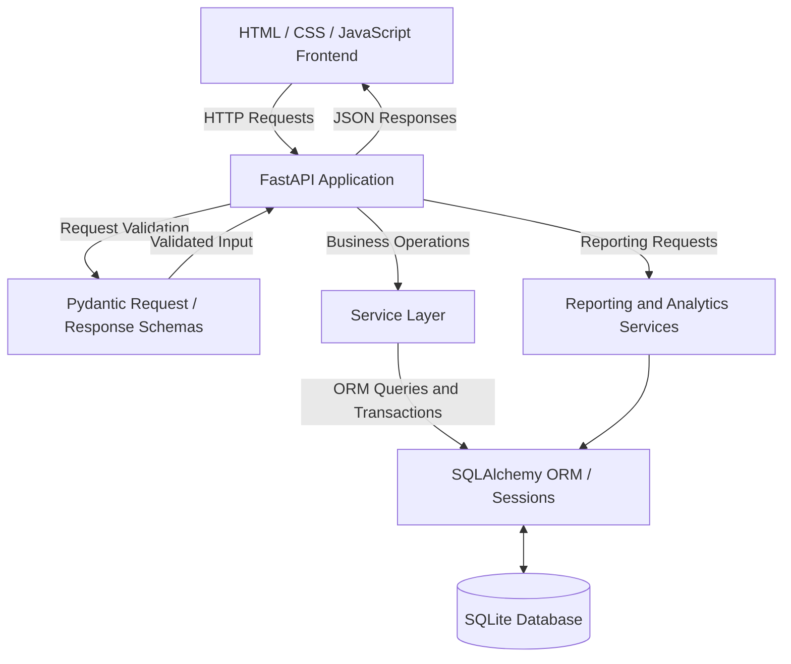

# LibraFlow — System Architecture

## Overview

LibraFlow uses a modular FastAPI backend with separate
API, validation, business logic, persistence, and
reporting responsibilities.

## High-Level Architecture



## Main Components

- **Frontend:** Displays books, members, loans, and reports.
- **API Layer:** Defines FastAPI routes and HTTP responses.
- **Schemas:** Validates request and response data.
- **Service Layer:** Implements business rules.
- **Models:** Defines SQLAlchemy database tables.
- **Database Layer:** Manages sessions and persistence.
- **Reporting Services:** Produces library analytics.

## Database Relationships

- One Book can have multiple Loans.
- One Member can have multiple Loans.
- Each Loan references one Book and one Member.

## Transaction Safety

Borrowing a book updates inventory and creates a loan
within one transaction.

Returning a book updates the loan state and restores
inventory within one transaction.

Failed transactional operations trigger a rollback.

## Current Limitations

- No authentication or role-based authorization.
- SQLite is used for local development.
- Advanced concurrency testing remains future work.
```